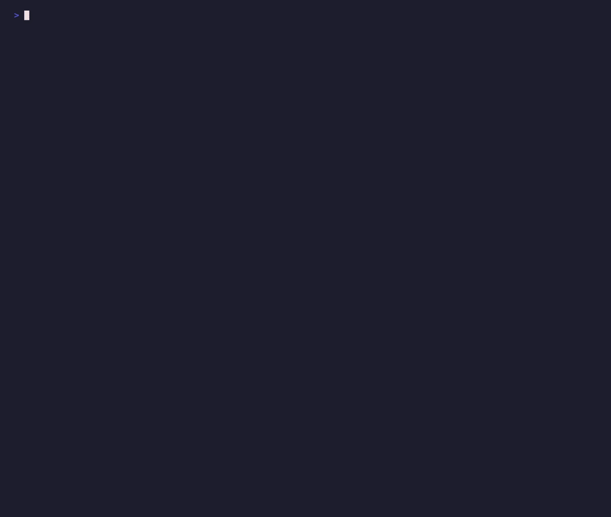
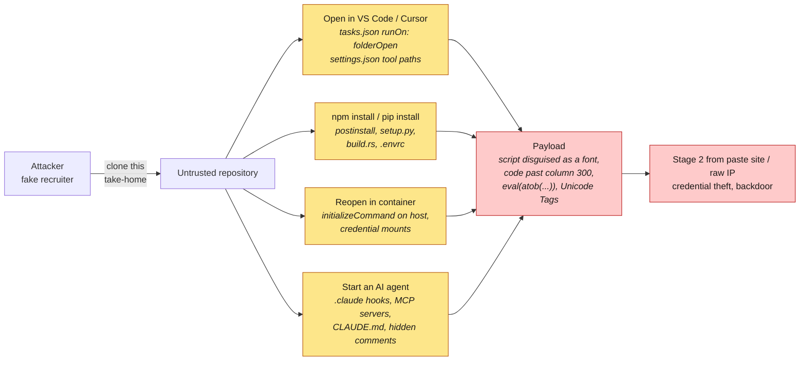

# preflight

**Check a repository before you open it.**



`preflight` is a static scanner that finds code which would run *automatically* when you
open a repository in your IDE, install its dependencies, open its dev container, or point
an AI coding agent at it. It never executes anything from the repository it scans.

It was built in response to the North Korea-linked **"Contagious Interview"** campaigns,
in which fake recruiters send developers a "take-home assignment" repository. Opening
it in VS Code and clicking *Trust* runs a hidden task (`"runOn": "folderOpen"`) that installs
a backdoor. The task usually executes a file disguised as a font or image, padded with
whitespace so the malicious code sits off-screen.

```console
$ preflight clone https://github.com/recruiter/interview-task

  DANGER   interview-task   score 100/100   5 files scanned

 [CRITICAL] .vscode/tasks.json:4  PF101 vscode-folderopen-task
            Task "setup-fonts" runs automatically when the folder is opened
            → node public/fonts/fa-solid-900.woff2

 [CRITICAL] .vscode/tasks.json:4  PF001 auto-exec-chain
            Opening the folder in VS Code executes public/fonts/fa-solid-900.woff2,
            which contains: disguised-file, decode-and-execute

 [CRITICAL] package.json:1  PF001 auto-exec-chain
            Installing dependencies executes server/setup.js,
            which contains: remote-code-execution, payload-host
 ...
 Do not open this repository in VS Code/Cursor, run npm install, or start an AI agent in it.
```

## Threat model



preflight reads the **triggers** (yellow) and the **payload signals** (red) and reports a
`PF001 auto-exec-chain` when a trigger executes a file that carries a payload signal.
Everything is static: the repository is never built, installed or run.

## What it checks

| Trigger | Where | Examples |
|---|---|---|
| Opening the folder in VS Code / Cursor | `.vscode/tasks.json`, `.vscode/settings.json`, `*.code-workspace` | `runOn: folderOpen` tasks, `task.allowAutomaticTasks`, interpreter/tool paths pointing into the repo, `NODE_OPTIONS` injection |
| Opening the dev container | `devcontainer.json` | `initializeCommand` (runs **on the host**), lifecycle commands, mounting `~/.ssh` / `~/.aws`, `--privileged` |
| Installing dependencies | `package.json`, `setup.py`, `pyproject.toml`, `build.rs` | `preinstall`/`postinstall`/`prepare`, `curl \| sh`, `core.hooksPath` hijacking, git/URL dependencies, in-tree build backends |
| Entering the directory | `.envrc` | direnv scripts |
| Running git | `.gitmodules`, `.gitattributes`, `.husky/` | `ext::` submodule URLs, paths into `.git/`, hook installers |
| Starting an AI coding agent | `.claude/settings.json`, `.mcp.json`, `.cursor/mcp.json`, `.vscode/mcp.json`, `CLAUDE.md`, `AGENTS.md`, `.cursorrules` … | hooks, auto-approved MCP servers, `ANTHROPIC_BASE_URL` redirection, `bypassPermissions`, prompt injection hidden in HTML comments |
| Content (any file) | everything | Unicode Tag smuggling (decoded for you), Trojan Source bidi characters, zero-width characters, off-screen code, decode-and-`eval`, download-and-execute, encoded blobs, paste-site payload hosts, raw IP URLs |
| Filesystem | everything | scripts or executables disguised as fonts/images (magic-byte check), committed binaries, symlinks escaping the repo |

Run `preflight rules` for the full list of rules.

### Chains, not just signals

Lots of legitimate projects have a `postinstall` script, and lots of minified files contain
`eval`. What is rare is a trigger that executes a file which is itself suspicious.
`preflight` resolves the files each trigger would run (including `node server` → `server/index.js`)
and raises a **PF001 auto-exec-chain** finding when the two meet.

## False positives

Scanned against the **1,000 most-starred GitHub repositories**: 92.9% CLEAN, 6.8% REVIEW,
0.3% DANGER. The three DANGER verdicts are real instances of the mechanism (VS Code's
own `folderOpen` task, an `.exe` renamed to `.zip`, a corpus of Unicode Tag characters),
and most REVIEW verdicts are genuine auto-execution configuration: Claude Code hooks,
dev-container host commands, auto-approved MCP servers. Details and the tuning history
are in [bench/results.md](bench/results.md).

## Install

Download a binary from the [releases page](https://github.com/howardhsieh/preflight/releases)
(Linux, macOS and Windows, amd64 and arm64; every archive is listed in `checksums.txt`
and carries a GitHub build-provenance attestation), or build from source:

```bash
go install github.com/howardhsieh/preflight/cmd/preflight@latest
```

The tool has **zero third-party dependencies**; it uses only the Go standard library.

## Usage

```bash
preflight clone <url> [dir]      # hardened clone, then scan
preflight scan [path]            # scan a directory you already have
preflight scan . -f sarif -o preflight.sarif   # for GitHub code scanning
preflight scan . -f json --fail-on critical    # for scripts / CI gates
```

`preflight clone` runs `git clone` with submodules, hooks, LFS smudging, `fsmonitor`
and the `file://` / `ext::` transports disabled. It also persists `core.hooksPath=/dev/null`
into the new repository.

| Flag | Default | |
|---|---|---|
| `-f, --format` | `table` | `table`, `json` or `sarif` |
| `-o, --output` | stdout | write the report to a file |
| `--fail-on` | `high` | exit 1 if any finding is at least this severe (`none` to disable) |
| `--min-severity` | `low` | hide table rows below this severity |
| `--exclude` | | skip paths or globs (repeatable, comma-separated) |
| `--no-color` | | also honours `NO_COLOR` |

## GitHub Action

Scan every pull request, and publish findings to the Security tab via SARIF:

```yaml
permissions:
  contents: read
  security-events: write

steps:
  - uses: actions/checkout@v5
  - uses: howardhsieh/preflight@v0.1.0
    with:
      fail-on: high            # none | low | medium | high | critical
      sarif-file: preflight.sarif
  - uses: github/codeql-action/upload-sarif@v3
    with:
      sarif_file: preflight.sarif
```

| Input | Default | |
|---|---|---|
| `path` | `.` | directory to scan |
| `fail-on` | `high` | fail the step at or above this severity |
| `exclude` | | comma-separated paths or globs to skip |
| `sarif-file` | | also write a SARIF report here |
| `version` | `latest` | release tag to install |

Outputs: `verdict` (`CLEAN`, `REVIEW`, `DANGER`) and `score` (0–100). The action verifies
the downloaded binary against the release checksums before running it.

## Design principles

- **Never execute the target.** No `npm`, no interpreter, not even `git status`, because
  a repository's own `.git/config` can define an `fsmonitor` command. Files are read
  with size limits, and symlinks are recorded but never followed.
- **Explain the trigger.** Every finding says *what you would have to do* for the code to run.
- **No dependencies, no network.** The scanner cannot be the supply-chain risk it looks for.

## Limitations

- `preflight` finds code that runs **automatically or on the first obvious command**. It is not
  a malware scanner and does not prove that the rest of the code is safe.
- Heuristics can be evaded by a determined attacker. Treat a `CLEAN` result as "no known
  auto-execution vector", and still open untrusted code in a VM or Codespace.
- Python virtualenvs are summarised (PF106) rather than scanned.

## Further reading

- [How preflight works](docs/writeup.md) — the attack, the trigger × content design,
  and what 1,000 popular repositories taught the rules.
- [Benchmark results](bench/results.md).

## Development

```bash
go test -race ./...
go run ./cmd/preflight scan .
```

The test fixtures are generated inside the tests, and the demo repository in the GIF is
generated by `docs/demo/make-demo-repo.sh`, so this repository contains no files that
look like attacks. Every "payload" decodes to `console.log(...)`. Re-record the demo with
`docs/demo/record.sh` (needs [vhs](https://github.com/charmbracelet/vhs)).

## License

MIT
